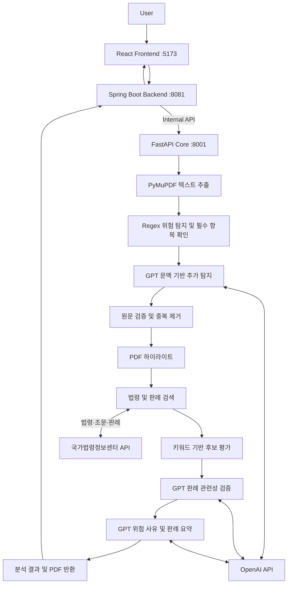

# 🏠 SafeRentAI

### AI 기반 임대차계약서 위험 분석 서비스


**SafeRentAI**는 임대차계약서 PDF에서 임차인에게 불리할 가능성이 있는 조항을 자동으로 탐지하고, 실제 법령 및 판례를 바탕으로 위험 사유와 검토 사항을 제공하는 AI 기반 계약서 검토 지원 서비스입니다.

정규표현식 기반 탐지와 LLM 기반 문맥 분석을 결합하여 계약서의 위험 신호를 확인하고, 법률 지식이 부족한 사용자도 계약 내용을 쉽게 이해할 수 있도록 지원합니다.

## 📌 Project Overview

임대차계약에는 보증금 반환, 수선 의무, 계약 해지 등 임차인의 재산과 주거 안정성에 영향을 미치는 조건이 포함됩니다. 그러나 복잡한 법률 용어와 특약으로 인해 일반 사용자가 불리한 조건을 파악하기 어려울 수 있습니다.

SafeRentAI는 이러한 정보 비대칭을 줄이고 계약 체결 전 검토를 지원하기 위해 개발되었습니다.

## ✨ Key Features

### 01. PDF 계약서 분석

- PDF 파일 업로드 및 PyMuPDF 기반 텍스트 추출
- 최대 20MB, 100페이지 지원
- PDF 시그니처 및 암호화 여부 검증
- 텍스트가 없는 스캔 PDF에 대한 OCR 필요 안내

### 02. 하이브리드 위험 조항 탐지

정규표현식으로 명시적인 위험 표현을 탐지하고, GPT를 활용하여 계약서 전체 문맥에서 추가 위험 후보를 찾습니다.

| 위험 수준 | 위험 유형 | 탐지 대상 예시 |
|---|---|---|
| 🔴 위험 | 보증금 반환 제한 | 반환 거절, 조건부 반환, 일방적 반환 연기 |
| 🔴 위험 | 임대인의 임의 출입 | 임차인의 동의 없는 방문 및 출입 |
| 🟡 주의 | 과도한 수선비 부담 | 수리비의 일괄적인 임차인 부담 |
| 🟡 주의 | 일방적인 계약 해지 | 일방적 해지 권한 및 불리한 해지 조건 |
| 🟡 주의 | 관리비 변경 재량 | 일방적인 관리비 인상 및 불명확한 기준 |

- GPT 탐지 결과의 위험 유형, 페이지 번호 및 PDF 원문 일치 여부 검증
- 동일 유형·페이지의 포함 관계에 기반한 중복 탐지 방지
- 위험 사유 및 구체적인 수정·확인 권고 제공

위험 수준은 시스템의 사전 정의 기준에 따른 검토 신호이며, 법적 위법성을 확정하지 않습니다.

### 03. 법령 및 판례 검색

국가법령정보센터 Open API를 활용하여 관련 법령과 조문, 대법원 판례를 조회합니다.

- 위험 유형별 법령 및 판례 검색어 설정
- 법령명과 조문 번호를 기반으로 실제 조문 조회
- 여러 검색어를 활용한 판례 후보 수집 및 중복 제거
- 판시사항, 판결요지, 참조조문을 활용한 후보 점수 산정
- 상위 3개 판례 후보에 대한 GPT 일괄 관련성 검증

| 관련성 | 의미 |
|---|---|
| Direct | 위험 유형의 핵심 법적 쟁점과 직접 관련 |
| Indirect | 참고할 법리를 제공하지만 핵심 쟁점과 간접 관련 |
| Irrelevant | 핵심 법적 쟁점의 관련성이 부족 |
| Unverified | 관련성 검증 결과를 확보하지 못함 |

법적 근거 설명에서는 직접 관련 판례를 우선 선택하며, 관련성이 부족하거나 검증에 실패한 후보는 제외합니다. 별도의 관련 판례 검색 목록은 참고용 검색 결과입니다.

### 04. GPT 기반 법적 근거 분석

실제로 조회된 법률 조문 및 판례 자료를 GPT에 전달하여 다음 정보를 생성합니다.

- 판례 핵심 판단 요약
- 계약 조항의 위험 사유 분석
- 판례와 계약 조항의 사실관계 차이 및 적용 한계
- 추가 확인이 필요한 사항

제공되지 않은 법률이나 판례를 생성하지 않도록 프롬프트를 구성하고, 조회된 근거가 없는 경우 상세 분석을 수행하지 않습니다.

### 05. PDF 하이라이트 및 다운로드

- 🔴 빨간색: 위험 조항
- 🟡 노란색: 주의 조항
- 분석 결과와 원본 계약서 비교
- 하이라이트가 적용된 PDF 다운로드
- 원문 위치를 찾지 못한 경우 하이라이트 여부 별도 표시

### 06. 필수 계약 항목 확인

보증금, 월세 또는 차임, 계약기간, 관리비, 임대인·임차인, 목적물 주소의 기재 여부를 정규표현식으로 확인합니다. 누락 가능성을 안내하며, 실제 기재 여부에 대한 최종 판단은 사용자가 원문을 확인해야 합니다.

## 🛠 Tech Stack

| Category | Technologies |
|---|---|
| Frontend | React, TypeScript, Vite, CSS |
| Backend | Java 17, Spring Boot, WebFlux |
| Analysis Core | Python, FastAPI, Pydantic |
| PDF Processing | PyMuPDF |
| Risk Detection | Regular Expressions, OpenAI GPT-5.1 |
| Legal Data | 국가법령정보센터 Open API, Requests |
| AI Integration | OpenAI Responses API, JSON 응답 |
| Optimization | ThreadPoolExecutor, 요청 내 결과 재사용 |
| Build & Dependency | npm, Gradle, Poetry |
| Version Control | Git, GitHub |

GPT-5.1은 코드의 기본 모델이며 `OPENAI_MODEL` 환경변수로 변경할 수 있습니다. 별도의 모델 학습이나 파인튜닝 없이 API 기반 추론을 활용합니다.

## 🏗 System Architecture



## ⚙️ Analysis Pipeline

1. 계약서 PDF 업로드 및 파일 검증
2. 페이지별 텍스트 추출
3. Regex 기반 위험 탐지 및 필수 항목 확인
4. GPT 기반 추가 위험 탐지
5. 위험 유형·페이지·원문 검증 및 중복 제거
6. 위험 수준별 PDF 하이라이트 생성
7. 관련 법령 및 판례 검색
8. 키워드 점수 기반 판례 후보 선정 및 GPT 관련성 검증
9. 실제 검색 자료 기반 GPT 위험 분석
10. 분석 결과와 하이라이트 PDF 반환

### 처리 효율 개선

- 동일 위험 유형의 법령·판례 검색 결과 재사용
- 판례 검색어별 최대 5개 후보 수집 및 최대 10개 상세 조회
- 키워드 점수 상위 3개 후보를 GPT 요청 한 번으로 검증
- 법적 근거 분석과 조항별 GPT 상세 분석에 각각 최대 3개 작업 병렬 처리
- 동일 위험 유형과 원문에 대한 상세 분석 결과 재사용

## 📂 Project Structure

```text
SafeRentAI/
├── frontend/                 # React + TypeScript UI
│   └── src/
│       ├── App.tsx
│       └── style.css
├── backend/                  # Spring Boot API
├── core/                     # FastAPI 분석 서버
│   └── app/
│       ├── main.py           # 분석 파이프라인 및 PDF 처리
│       ├── law_api.py        # 국가법령정보센터 API 연동
│       ├── legal_reasoning.py # 법령·판례 검색 및 후보 평가
│       ├── llm_detection.py  # GPT 위험 조항 탐지
│       └── llm_analysis.py   # GPT 판례 검증 및 상세 분석
├── .gitignore
└── README.md
```

## 🚀 Getting Started

### Prerequisites

- Git, Node.js 및 npm
- Java 17
- Python 및 Poetry
- 국가법령정보센터 Open API 인증 정보
- OpenAI API Key

### 1. Clone Repository

```bash
git clone https://github.com/ddubi0521/SafeRentAI.git
cd SafeRentAI
```

### 2. Run Analysis Core

Windows PowerShell에서 실행합니다.

```powershell
cd core
poetry install

$env:CORE_SHARED_TOKEN = "your-local-core-token"
$env:LAW_API_OC = "your-law-api-id"
$env:OPENAI_API_KEY = "your-openai-api-key"
$env:OPENAI_MODEL = "gpt-5.1"

poetry run uvicorn app.main:app --reload --port 8001
```

Core 상태 확인: <http://localhost:8001/health>

### 3. Run Backend

프로젝트 루트에서 별도의 PowerShell 터미널을 열어 실행합니다.

```powershell
cd backend
$env:CORE_SHARED_TOKEN = "your-local-core-token"
$env:CORE_BASE_URL = "http://127.0.0.1:8001"
$env:LOCAL_DEV_NO_AUTH = "true"

.\gradlew.bat bootRun
```

### 4. Run Frontend

프로젝트 루트에서 별도의 터미널을 열어 실행합니다.

```powershell
cd frontend
npm install
npm run dev
```

브라우저 접속: <http://localhost:5173>

### Environment Variables

| Variable | Service | Description |
|---|---|---|
| `CORE_SHARED_TOKEN` | Core, Backend | 내부 API 인증 토큰 (동일한 값 사용) |
| `LAW_API_OC` | Core | 국가법령정보센터 API 인증 정보 |
| `OPENAI_API_KEY` | Core | OpenAI API 인증 키 |
| `OPENAI_MODEL` | Core | 사용할 모델 (기본값: `gpt-5.1`) |
| `CORE_BASE_URL` | Backend | Core 서버 주소 |
| `LOCAL_DEV_NO_AUTH` | Backend | 로컬 개발용 인증 생략 설정 |

`LOCAL_DEV_NO_AUTH=true` 및 `--reload`는 로컬 개발용입니다. 운영 환경에서는 적절한 인증과 보안 설정을 사용해야 합니다. 실제 API 키와 계약서 원본은 저장소에 커밋하지 마세요.

## 🔌 API Endpoints

| Method | Endpoint | Description |
|---|---|---|
| POST | `/api/tools/safe-rent/analyze` | Backend 계약서 분석 요청 |
| GET | `/health` | Core 상태 확인 |
| POST | `/internal/analyze` | Core 내부 PDF 분석 (`x-core-token` 필요) |
| GET | `/api/laws?query=민법` | Core 법령 검색 |
| GET | `/api/cases?query=임대차보증금` | Core 판례 검색 |

## 📚 Data & External APIs

| Source | Usage |
|---|---|
| 사용자 업로드 PDF | 계약서 원문 및 특약 분석 |
| [국가법령정보센터 Open API](https://open.law.go.kr/) | 법령 검색, 조문 조회, 대법원 판례 검색 및 상세 조회 |
| [OpenAI API](https://platform.openai.com/) | 문맥 기반 위험 탐지, 판례 관련성 검증, 법적 근거 설명 |

계약서 텍스트는 LLM 분석 과정에서 외부 OpenAI API에 전달됩니다. 개인정보가 포함된 계약서는 적절한 권한과 개인정보 보호 조치를 확인한 후 사용해야 합니다. 코드의 `store=False` 설정은 모든 외부 데이터 보존이 없음을 보장하지 않습니다.

## 📈 Future Improvements

- [x] PDF 텍스트 추출 및 위험 조항 하이라이트
- [x] 국가법령정보센터 API 연동
- [x] GPT 기반 문맥 위험 탐지
- [x] 판례 후보 평가 및 GPT 관련성 검증
- [x] GPT 기반 판례 요약 및 위험 사유 분석
- [ ] 위험 유형 세분화 및 15개 유형으로 확장
- [ ] 개별 조항 문맥 기반 판례 검색 및 관련성 평가 개선
- [ ] 필수 계약 항목 탐지 정확도 개선
- [ ] 계약서 위험도 종합 점수 제공
- [ ] 스캔 PDF OCR 지원
- [ ] 분석 결과 리포트 기능 확장

## ⚠️ Disclaimer

SafeRentAI는 계약서 검토를 지원하는 서비스로 전문적인 법률 자문을 대체하지 않습니다. 위험 탐지 및 판례 관련성 평가에는 오류나 누락이 발생할 수 있으며, 외부 API 장애 시 일부 분석 결과가 제공되지 않을 수 있습니다.

분석 결과는 계약 조항의 위법성·무효 또는 계약의 안전성을 보증하지 않습니다. 실제 계약 체결 전에는 최신 법령, 등기부등본, 선순위 권리관계 등을 별도로 확인하고 필요한 경우 전문가의 검토를 받으세요.

---

**SafeRentAI — 더 안전한 임대차계약을 위한 스마트 계약서 분석 서비스.**
